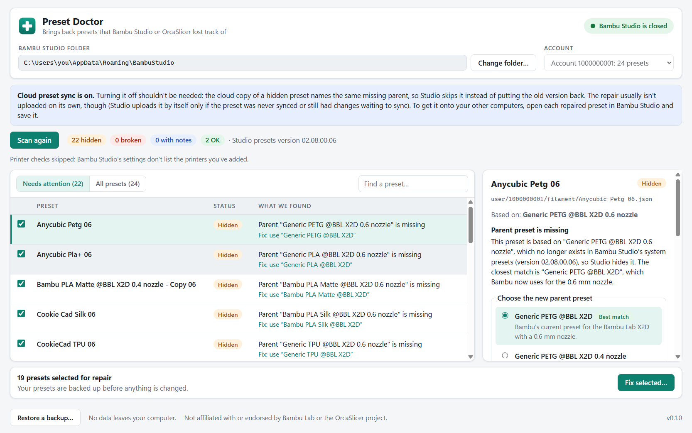
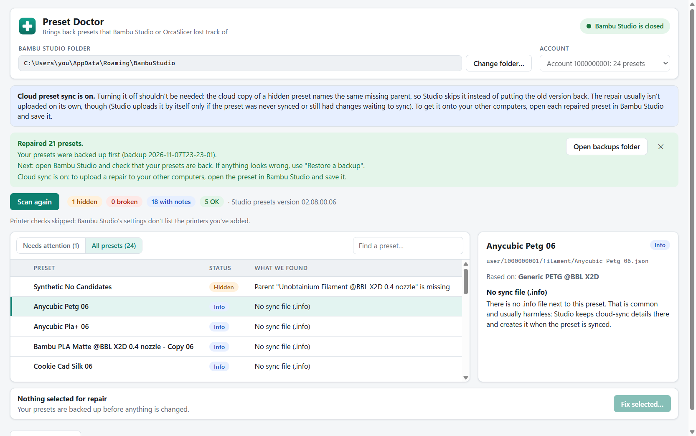
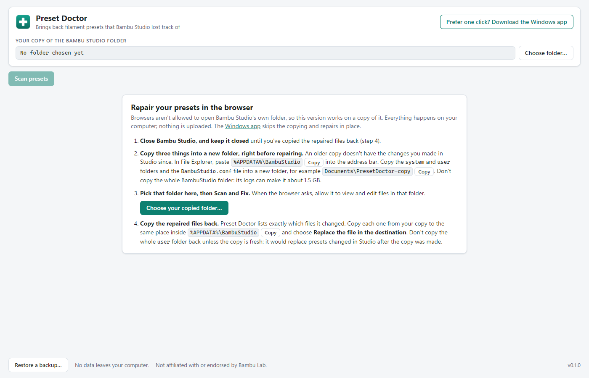

# Preset Doctor

**Finds and repairs custom Bambu Studio filament presets that disappeared after a Studio update.**

Free, open source, works offline. Windows. Not affiliated with Bambu Lab.

| Before | After |
|---|---|
|  |  |

## What it does

You update Bambu Studio and some of your own filament presets are gone. They don't show in the
dropdown, or they turn up under "Unsupported". The files are still on your computer, but Studio
can't use them anymore.

**Why it happens:** each custom preset remembers the Bambu preset it was based on, by **name**
(for example `Generic PETG @BBL X2D 0.6 nozzle`). Studio updates sometimes rename those built-in
presets, for example to `Generic PETG @BBL X2D`. Your preset then points at a name that no
longer exists, so Studio hides it.

**What Preset Doctor does:**

1. It reads your Bambu Studio folder and lists every filament preset as **OK**, **Hidden** or
   **Broken**, with a plain-English reason.
2. For each hidden preset, it finds the built-in preset it most likely meant and shows how sure it
   is (high, medium or low).
3. It shows you the exact change. After you click **Fix**, it backs up your presets and changes
   only the one line that names the parent.

## Download

Get the `.exe` file from
**[GitHub Releases](https://github.com/shmehltr/preset-doctor/releases)**. It is a portable app,
so there is nothing to install: download it and double-click it.

**"Windows protected your PC"**: Windows shows this for apps without a paid code-signing
certificate, and Preset Doctor doesn't have one. Click **More info**, then **Run anyway**. If you
would rather check it first, the source code is all in this repo and the exe is built from it by
[GitHub Actions](.github/workflows/release.yml).

## Web version (no download)

**[shmehltr.github.io/preset-doctor](https://shmehltr.github.io/preset-doctor/)** runs the same
app in Chrome or Edge on your computer. Nothing is uploaded: the page reads and changes files on
your computer only, and its security policy blocks all network requests.

**Which one should I use?**

| | Windows app | Web version |
|---|---|---|
| Steps | Scan, Fix. It repairs `%APPDATA%\BambuStudio` in place. | Copy folders out, Scan, Fix, copy the changed files back. |
| Checks that Studio is closed | Yes, on its own. | No; you tick "I've closed Bambu Studio". |
| Needs | Running an unsigned exe. | Chrome or Edge (Firefox and Safari can't open folders). |

Browsers aren't allowed to open anything under `%APPDATA%`, so the web version works on a copy:

1. **Close Bambu Studio and keep it closed** until step 4 is done. Also turn off preset sync or
   log out of Studio.
2. Right before repairing (an older copy lacks your newer Studio changes), in File Explorer, paste `%APPDATA%\BambuStudio` into the address bar. Copy the **`system`** and
   **`user`** folders and the **`BambuStudio.conf`** file into a new folder, for example
   `Documents\PresetDoctor-copy`. Don't copy the whole BambuStudio folder: its logs can make it
   about 1.5 GB.
3. Open the web version, click **Choose your copied folder**, pick that folder and allow editing.
   Then **Scan**, review, tick **I've closed Bambu Studio** and click **Fix selected**. A backup zip
   of the `user` folder goes into `preset-doctor-backups` inside your copy (and you can download
   it).
4. **Copy the repaired files back.** The page lists exactly which files changed: copy each one
   from your copy to the same place inside `%APPDATA%\BambuStudio` and choose **Replace the file
   in the destination**. Don't copy the whole `user` folder back unless you made the copy just
   now and Studio stayed closed since, or it replaces presets you changed in Studio after the copy.



## How to use it

1. **Close Bambu Studio.** Preset Doctor won't change anything while Studio is running, because
   Studio could overwrite the repair when it saves.
2. **Turn off preset sync, or log out of Bambu Studio.** If cloud sync is on, the cloud copy of a
   preset may undo the fix the next time Studio syncs. Preset Doctor warns you when sync is on.
3. **Open Preset Doctor, scan, review, fix.**
   - Click **Scan**. It finds your Bambu Studio folder (`%APPDATA%\BambuStudio`) on its own.
   - Click a hidden preset to see why it's hidden, the suggested new parent and the exact change.
     If the suggestion looks wrong, pick another candidate or leave that preset alone.
   - Click **Fix selected**. Then open Bambu Studio and check that your presets are back.

## Safety

- **Backup first.** Before the first change, it zips your whole `user` folder to
  `%APPDATA%\PresetDoctor\backups\`. **Restore backup** puts it back with one click.
- **You see every change.** Each repair is shown as a diff before anything is written, and nothing
  is written until you click.
- **Never writes while Studio is running.** It checks for `bambu-studio.exe` and refuses if Studio is
  running, or if it can't tell whether it is.
- **Small, careful edits.** It changes one line per preset and keeps the file's formatting. It
  writes to a temporary file first and then swaps it in, so a crash can't leave a half-written
  preset. If a file changed after the scan, it stops and asks you to scan again.
- **No network.** It makes no network connections of any kind. Your presets never leave your
  computer.
- **Built-in presets are never touched.** Only your own presets under `user\` are changed.

## Command line

The same engine also runs from a terminal, which is handy for checking before you use the app or for
scripting. You need [Node.js 24](https://nodejs.org/) and a clone of this repo:

```sh
git clone https://github.com/shmehltr/preset-doctor.git
cd preset-doctor
npm ci
npm run build

npx preset-doctor scan                 # list presets and problems (reads only)
npx preset-doctor fix --dry-run        # show the repairs as diffs (reads only)
npx preset-doctor fix --apply --yes    # back up, then repair (close Studio first)
npx preset-doctor backups              # list backups
npx preset-doctor backups restore <id> --yes
```

`node packages/core/dist/cli.js <command>` works too. Useful options:

| Option | Meaning |
|---|---|
| `[folder]` | Bambu Studio folder. Default `%APPDATA%\BambuStudio`. |
| `--user <id>` | Which account folder under `user\`. Default: the one with the most presets. |
| `--json` | Machine-readable scan output. |
| `--no-base-id` | Don't update `base_id` in the `.info` sync files. |
| `--from-other-folder` | `backups restore` only: put back a backup that was made from a different folder. |
| `--backups <dir>` | Where backups go. Default `%APPDATA%\PresetDoctor\backups`. |

Exit codes: `0` OK, `1` hidden or broken presets found, `2` bad command line, `3` read or write
failure (for `scan`, also: the system presets couldn't be read, so parents weren't checked), `4`
refused for safety (Studio running, files changed during the run, or a backup from another folder).
`fix --apply` makes only the repairs Preset Doctor is confident about. Use the app to pick other
candidates.

## FAQ

**What if it picks the wrong parent?**
Settings you changed yourself (temperatures, flow and so on) stay in your preset. Only the parent
it builds on changes. If the result looks wrong in Studio, close Studio and click **Restore
backup** (or run `preset-doctor backups restore <id> --yes`). Then pick a different candidate, or
leave that preset alone.

**It says "no candidates". Now what?**
Bambu removed or renamed that filament so much that there is no safe guess. The preset is
reported but not changed. You can recreate it in Studio from a similar filament.

**Some presets are "OK, with notes". Should I worry?**
No. Notes cover harmless things, like a missing `.info` sync file or a name that differs from the
file name only in capital letters. Studio still shows those presets.

**Does it work with OrcaSlicer, or on Mac?**
Not yet. It supports Bambu Studio on Windows, and filament presets only.

**What does it change exactly?**
It changes the `inherits` line in the preset's `.json` file. If the preset has a `.info` sync file
with a `base_id` line, it also changes `base_id` to match the new parent, as Studio does itself.
It never touches `updated_time`. If a preset's internal name doesn't match its file name, it can
also fix the name.

## Development

npm workspaces, TypeScript (strict), Vitest, ESLint and Prettier, on Node 24.

```
packages/core/   scan, rules, fixes, backups and the CLI. Pure TypeScript; file access is behind an
                 interface (PresetFs) so tests run in memory. Node-only code is in src/node/.
packages/ui/     the one-screen React UI and the PresetDoctorApi contract it calls as
                 window.presetDoctor. Shared by both apps; AppConfig.platform switches the few
                 web/desktop differences.
apps/desktop/    Electron + React app (electron-vite). The main process runs core; the UI talks
                 to it over a small typed IPC.
apps/web/        Vite + React static site for GitHub Pages. Runs core in the page over a picked
                 folder (File System Access API).
scripts/         fixture generator.
```

```sh
npm ci
npm run lint
npm run typecheck
npm run build
npm test                       # unit + fixture tests
PRESET_DOCTOR_LIVE=1 npm test  # also scans your real Studio folder, read-only
npm run desktop:dist           # build the portable exe into apps/desktop/release/
npm run desktop:e2e            # desktop end-to-end test on a temp copy of a fixture
npm run web:dev                # web version with hot reload
npm run web:build              # static site into apps/web/dist/
npm run web:e2e                # web end-to-end test in Edge or Chrome
```

Why the web version works on a copy: Chromium won't let a web page pick `%APPDATA%` folders at
all (see [SPEC.md §2](SPEC.md#2-step-0-pick-the-form-do-this-first-5-minutes)). The
[Pages workflow](.github/workflows/pages.yml) publishes `apps/web/dist` after CI passes for a push
to `main` (the repo's Pages source must be set to "GitHub Actions"). Releases come from a `v*` tag,
which must match the `version` in every `package.json` (all workspaces share one version).

### Contributing: fixtures

Tests run against real Studio folders in `packages/core/src/__fixtures__/`. When a Studio update
renames presets again, regenerate them from your own install:

```sh
npm run fixtures                         # reads %APPDATA%\BambuStudio
npm run fixtures -- "D:\copy\BambuStudio"  # or a copy of it
```

The script only **reads** the Studio folder. It anonymizes what it copies: account ids become
`1000000001`, `1000000002` and so on, user `setting_id`s get fake values, and `BambuStudio.conf` is
generated from scratch, because the real one holds login tokens and printer serials. It stops if a
real id is left in the output. Still, read the diff before committing, because custom preset
names are copied as they are.

Bug reports: please use the [bug report template](.github/ISSUE_TEMPLATE/bug_report.md) and include
the `scan --json` output (remove your account id first).

## License and disclaimer

[MIT](LICENSE). Preset Doctor is not affiliated with, endorsed by, or sponsored by Bambu Lab.
Bambu Studio is a trademark of its owner.
